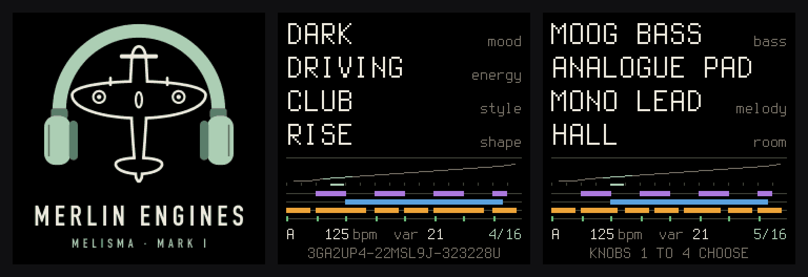
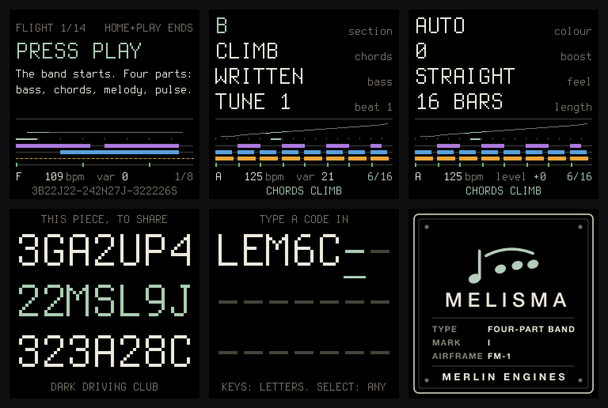

<p align="center"></p>

# Melisma

**A four-piece band you sit in with, for the M-VAVE FM-1.** *A Merlin Engines instrument.*



Melisma is open-source firmware that turns the FM-1 pocket synth into a band. You say how the music should feel
with dials labelled in plain words (a mood, an energy, a style, a shape) and the band writes and plays bass,
chords, melody and drums. Take any seat and play along: the keys only offer notes that fit, so you cannot play a
wrong one. It is made for people who do not read music, with enough under the surface for people who do.

- **Word dials, no theory.** Seven moods, five energies, twelve styles from house to bossa to ambient.
- **You cannot play a wrong note.** Four key layouts, from five always-safe notes to a plain piano.
- **94 instruments.** Analogue-style leads, basses and pads, FM pianos, bells, mallets, brass and reeds, through
  a chorus and a choice of five rooms.
- **Made for performing.** Mute and solo on the bar line, fills, sections, eight scenes, eight ways for each part
  to play, a looping recorder with undo.
- **Nothing is lost.** No randomness: the same settings always give the same music. A whole piece is a
  21-character code you can read out to a friend, and type in on the instrument.
- **A lesson built in.** A fourteen-step training flight teaches the instrument on the instrument.
- **64 shipped pieces**, and a button for a whole new one.

## Status

Version 1.0 is new. Please read this before installing.

- It was developed and played on **one FM-1**, a late-2026 unit with the newer flash chip (UC25HQ80, `0xB36014`)
  and m-bootloader. It has not been tried on the older Puya chip. The platform underneath (Dinghy) supports both.
- The released 1.0 package is installed on that unit and in regular use there.
- Every build is checked on a computer: about 19 million engine checks, a measurement of every instrument, the
  platform's own test suite, and a timing run of the heaviest possible band in an emulator.
- The sound was designed by measurement and by one pair of ears. Reports of instruments that sound wrong are welcome.

## Install

**[docs/INSTALL.md](docs/INSTALL.md)** has the steps, and how to go back. In short: take a backup, put the FM-1
in download mode, and install the `.fwsc` package from the [latest release](../../releases/latest) with
[M-Flasher](https://jvitkauskas.github.io/m-apps/flasher/).

Unofficial, and not affiliated with M-VAVE. Installing firmware is at your own risk.

## Learn it

| | |
|---|---|
| **[Pilot's Notes](docs/PILOTS-NOTES.md)** | The full guide: every control, every instrument, every style |
| **[Quick reference](docs/QUICK-REFERENCE.md)** | One page to keep beside the instrument |
| **[Install and recovery](docs/INSTALL.md)** | Putting it on, taking it off, and what to do if something goes wrong |
| [Changelog](CHANGELOG.md) | What each version added |



## How it works

| | |
|---|---|
| `firmware/src/mel_engine.h` | The band: word dials in, notes out. A pure function of the settings, integers only |
| `firmware/src/mel_synth.h` | The sound: FM and analogue voices, drums, chorus and reverb, in the audio interrupt |
| `firmware/src/mel_presets.h` | The shipped pieces |
| `firmware/src/melisma.c` | The instrument: dials, sequencer, seats, keys, screen, storage |
| [docs/DESIGN.md](docs/DESIGN.md) | Why it is the way it is, and a log of what was built when |
| [docs/RESEARCH-NOTES.md](docs/RESEARCH-NOTES.md), [docs/SOUND-RESEARCH.md](docs/SOUND-RESEARCH.md) | The research behind the styles and the sound, with sources |
| [docs/FLASHING-SAFETY.md](docs/FLASHING-SAFETY.md) | How FM-1s get bricked and recovered, with sources |
| [docs/DINGHY.md](docs/DINGHY.md), `docs/API.md`, `docs/RULES.md` | The platform underneath |

## Build and check

Everything is checked on a computer before it goes near a unit.

```sh
tools/check.sh           # engine tests, reference pieces, every instrument measured, a scripted run (seconds)
tools/check.sh --full    # then the device build, the platform's tests, and timing runs in an emulator
tools/shots.sh           # the pictures in these docs, taken from the firmware itself
```

The device build needs JieLi's toolchain (`tools/get_toolchain.sh`), the AC79 SDK and, off Linux, Docker; see
[docs/DINGHY.md](docs/DINGHY.md). `tests/run_host.sh` runs the whole instrument on a computer and writes its
screens and sound to `build/host/`. `build/host/synth_test wav DIR` writes a short recording of every instrument.

Releases are built by GitHub from a tag, with a build attestation, so the package you download is provably the
one built from that commit.

## The logos

`assets/logo/` has the Merlin Engines badge and mark, the Melisma badge and the banner above, as SVG with the
lettering drawn as outlines (`tools/gen_logos.py` makes them). They mark this project; a fork should use its own.

<p>  </p>

## Credits and licence

GPL-3.0-only; see [LICENSE](LICENSE) and [LICENSING.md](LICENSING.md) for who made what.

Melisma stands on [Dinghy](https://github.com/zvenson/dinghy) by zvenson, which stands on
[Felucca](https://github.com/hugelton/Felucca) by Leo Kuroshita (Hügelton Instruments) and
[SLOOP](https://github.com/isod89/sloop-fm1) by isod89. Its oscillators, filter, chorus and reverb follow
designs from Emilie Gillet's Mutable Instruments modules, and its analogue voice follows Felucca-Engines.
It was written with the help of an AI assistant (Claude) and tested as described above.

"M-VAVE" and "FM-1" belong to their owners. Melisma is not made or endorsed by them.
