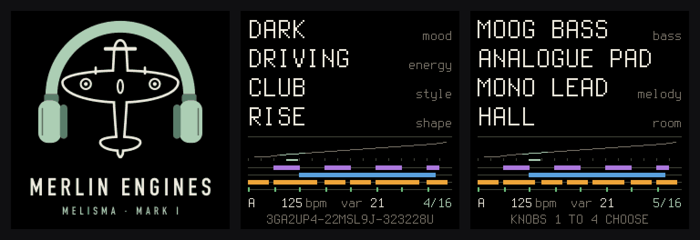
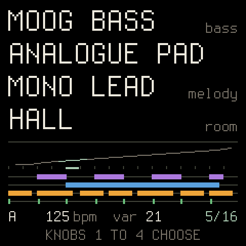
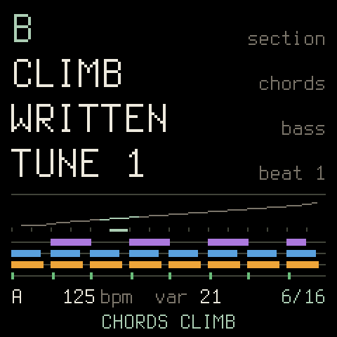
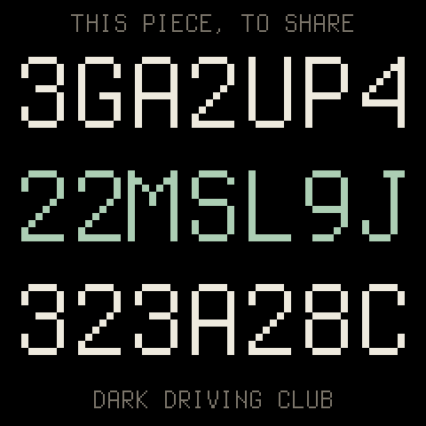
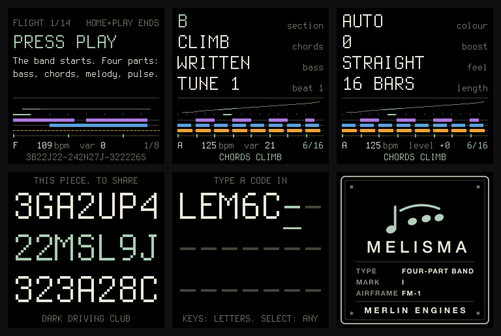

# Pilot's Notes: Melisma Mark I

*Merlin Engines. For the M-VAVE FM-1 airframe.*

Everything the instrument does, in the order you are likely to want it. For a one-page summary see the
[quick reference](QUICK-REFERENCE.md); to put it on your FM-1 see [INSTALL.md](INSTALL.md).

## Contents

1. [What it is](#1-what-it-is)
2. [Your first five minutes](#2-your-first-five-minutes)
3. [The words](#3-the-words)
4. [The styles](#4-the-styles)
5. [The four parts: muting, soloing, taking a seat](#5-the-four-parts)
6. [The keys: you cannot play a wrong note](#6-the-keys)
7. [Instruments, levels and the room](#7-instruments-levels-and-the-room)
8. [Performing: fills, sections, scenes, the panel](#8-performing)
9. [Recording a phrase](#9-recording-a-phrase)
10. [Shipped pieces, and a surprise](#10-shipped-pieces-and-a-surprise)
11. [Keeping and sharing](#11-keeping-and-sharing)
12. [The screen](#12-the-screen)
13. [Every control](#13-every-control)
14. [Emergencies](#14-emergencies)
15. [Limits of the Mark I](#15-limits-of-the-mark-i)

## 1. What it is

Melisma is a four-piece band you sit in with. You say how the music should feel, in plain words, and the band
writes and plays it: **bass, chords, melody, pulse** (the drums). You can take any of those seats and play it
yourself, and whatever you play fits.

- **No theory needed.** The dials are words: a mood, an energy, a style, a shape.
- **Nothing is random.** The same settings always give the same music, so nothing you like is ever lost.
- **A piece is a code.** Twenty-one characters hold the whole piece. Read it out to a friend and they have it.

## 2. Your first five minutes

A new instrument starts with a lesson, the **training flight**: fourteen short steps, each naming one thing to do.
It waits until you have done it, answers "ROGER", and moves on. The light of the control to use blinks, and the
instrument works normally underneath, so you are playing the real thing throughout.

- **HOME + PLAY** starts the flight at any time, and leaves it at once. The screen says so on every step.
- **HOME**, tapped on its own, passes over a step.

If you would rather find your own way:

1. Press **PLAY**. The band starts.
2. Turn **KNOB1** (mood), **KNOB2** (energy) and **KNOB3** (style). Each change lands on the next bar.
3. Play any keys. They all fit.
4. Turn **PRESETS** to hear the shipped pieces.
5. Hold **HOME** and tap **ARP** for a whole new piece.

## 3. The words

| Dial | Word | What it means |
|---|---|---|
| KNOB1 | **Mood** | bright, warm, wistful, sad, dark, dreamy, tense. It chooses the scale |
| KNOB2 | **Energy** | still, calm, moving, driving, frantic. How many notes, how high, how fast |
| KNOB3 | **Style** | The band's rhythmic language (section 4) |
| KNOB4 | **Shape** | What the piece does over its length: loop (level), rise, fall, arch, question and answer |

Hold **EDIT** and the same four knobs set finer things:

| With EDIT | Word | What it means |
|---|---|---|
| KNOB1 | **Colour** | The scale, chosen apart from the mood (AUTO follows the mood) |
| KNOB2 | **Boost** | Pushes the whole piece harder. It goes to eleven |
| KNOB3 | **Feel** | How the bar is counted: straight, swung, waltz (three), lilting (six), odd (seven) |
| KNOB4 | **Length** | 4 to 32 bars |

And around them:

| Control | What it sets |
|---|---|
| SELECT | The key (turn below C for AUTO) |
| ALGORITHM | The variation: another piece from the same words, 0 to 1023 |
| EDIT + ALGORITHM | The tempo, within what the energy or the style allows |

A dial turned while the band plays takes effect at the next bar line, so the music never stumbles.

## 4. The styles

A style gives the drums their pattern and, where the idiom has one, the bass its line and the chords their
rhythm. Whatever a style does not specify, the band writes as before. Some styles change when the feel is *swung*.

| Style | Straight feel | Swung feel | Tempo |
|---|---|---|---|
| FREE | The band's own writing | The same, swung | By energy, 60 to 170 |
| CLUB | House: kick on every beat, a tick on every offbeat | Two-step garage | 118 to 138 |
| STREET | Boom-bap: a loud snare on two and four, lazy kicks, one held chord | The same | 84 to 96 |
| FUNK | Funk: a heavy first beat, ghosted snares, an opening hat | New Orleans second line | 90 to 120 |
| ISLAND | Reggae one drop: nothing on the first beat, chords on the offbeats | The same | 65 to 85 |
| BREEZE | Bossa nova: quiet and even, a rim-click figure, a bass that arrives early | The same | 60 to 75 |
| FIESTA | Salsa: the clave, a bass that avoids the first beat, a piano figure | The same | 80 to 110 |
| LOUNGE | Jazz: ride cymbal, a walking bass, chords with sevenths | The same | 110 to 200 |
| ROADHOUSE | Country train beat: brushes, root and fifth | Shuffle blues | 70 to 130 |
| MOTOR | Motorik: it never varies, and takes no fills | The same | 120 to 150 |
| RUSH | Drum and bass: fast drums over a slow bass and a held chord | The same | 160 to 175 |
| DRIFT | Ambient: no drums at all | The same | 60 to 90 |

- **Energy** moves the tempo through the style's own range and thins the drums when low. It never adds notes the
  style does not have.
- A style applies when the feel is straight or swung. In waltz, lilting and odd the band plays free, and the
  style's label reads "in 4 only".
- Only patterns that could be checked against a source, or are standard beyond doubt, are included.

## 5. The four parts

The four buttons **FX, SCL, ENV, LFO** are the bass, the chords, the melody and the pulse.

| Do this | And |
|---|---|
| **Tap** a part's button | The part drops out at the next bar. Tap again and it comes back |
| **Hold** it for half a second | That seat is yours: the band stops playing it and the keys do. A tap hands it back |
| **EDIT** + the button | That part alone, for as long as you hold it |
| **HOME** + the button | Hold that part exactly as it is while you change everything else |
| **SEQ** + the button | That part's next way of playing (section 8) |
| **GLO** + the button | That part's next instrument (section 7) |

Each button's light says who is playing the part:

| Light | Meaning |
|---|---|
| Lit | The band plays it |
| Blinking | You play it: this is your seat |
| Glowing dimly | Held: frozen as it was |
| Dark | Out |

You can sit in one seat at a time. With no seat taken, the keys play over the band's melody.

- **Melody seat:** single notes.
- **Bass seat:** the same keys, two octaves down.
- **Chords seat:** one key plays the whole chord built on that note.
- **Pulse seat:** the keys are the five drums (thump, snap, tick, rim, open hat), repeating along the keyboard.

## 6. The keys

**You cannot play a wrong note.** The key lights show what fits: home notes are lit, other notes that fit glow.

There are four layouts. Hold **EDIT** and turn **SELECT** to change, at any time:

| Layout | What the keys do | For |
|---|---|---|
| **EASY** (the default) | Every key is the next of five notes that sound well over anything the band plays | Anyone. Run your fingers anywhere |
| **SCALE** | Every key is the next note of the piece's scale: seven to the octave | More colour, still no wrong notes |
| **SNAP** | A normal piano. A key outside the scale plays the nearest note that fits | Pianists who want a safety net |
| **PIANO** | A normal piano with no help | Pianists |

**Time lock.** Hold **EDIT** and press **PLAY** to switch it on or off. With it on, a key you press a little late
or early waits for the next beat division, so what you play is always in time with the band. Notes that are
already on the beat sound at once. It is off to begin with, because some players find the slight wait odd; try it
on the pulse seat first.

**OCT−** and **OCT+** move your keys down and up an octave.

## 7. Instruments, levels and the room

Hold **GLO** and the top of the screen becomes the band's line-up. While you hold it:

| Turn | To choose |
|---|---|
| KNOB1 | the bass's instrument |
| KNOB2 | the chords' instrument |
| KNOB3 | the melody's instrument |
| KNOB4 | the room: DRY, CLOSE, ROOM, HALL, FAR |

- With the band at rest, each instrument plays a note as you reach it, so you can hear it.
- Each knob offers that part's own kind of instrument first and then all the others. A part can play anything.
- The line-up and the room are part of the piece: they are kept in its code, its scenes and the shipped pieces.

**Levels.** Hold **HOME** and turn KNOB1, 2, 3 or 4 to set how loud the bass, the chords, the melody or the pulse
is, from 0 to 10 (7 is as made). The levels are yours, kept on the instrument, and apply to every piece.

**Overall level.** Hold **EDIT** and turn **PRESETS**, from −6 to +6. MASTER is the volume.

### The instruments (94)

They are made in two ways. **Analogue** ones are two detuned oscillators and a resonant filter that opens and
closes with each note. **FM** ones are one pure tone bending another, which is good at struck and blown sounds.

**Bass** (22)

| Instruments | What they are |
|---|---|
| ROUND, EDGE, SUB, PLUCK, SOFT BASS | Five FM basses, from mellow to biting |
| PICK BASS, SLAP BASS, FRETLESS | Electric basses: picked, slapped, and one that glides and sings |
| WOOD BASS, TUBA, CELLO | An upright that dies away; a tuba; a bowed cello that glides |
| MOOG BASS, ACID, RUBBER BASS | Filtered sawtooths: snapping, squealing, bouncing |
| REESE, UNISON BASS, SAW BASS, FUZZ BASS | Thick and grinding, each in its own way |
| PULSE BASS, DEEP SUB, BOOM BASS, ORGAN BASS | Hollow; nearly pure; a long low boom; organ pedals |

**Keys, plucked things, mallets, bells and pads** (41)

| Instruments | What they are |
|---|---|
| FM PIANO, TINE PIANO, FM GRAND, HONKY TONK | Pianos: warm, bell-like, grand, and out of tune on purpose |
| CLAV, HARPSICHORD | Short, bright plucks |
| FM ORGAN, JAZZ ORGAN, PIPE ORGAN, HARMONIUM, ACCORDION | Organs and reeds |
| MARIMBA, VIBES, KALIMBA, GLOCKENSPIEL, CELESTE, MUSIC BOX | Struck wood and metal, from warm to tiny |
| TUBULAR BELL, CRYSTAL, GLASS | Bells and glass |
| HARP, KOTO, DULCIMER, BANJO, SITAR, FM PLUCK, SYNTH PLUCK | Plucked strings and their synthetic cousins |
| POLY SAW | A bright synth for chords |
| SOFT PAD, ANALOGUE PAD, PWM PAD, SWEEP PAD, DARK PAD, GLASS PAD | Slow washes; SWEEP opens as it swells |
| SUPERSAW PAD, FIFTH PAD | Wide and thick; two notes a fifth apart |
| STRING MACHINE, WARM STRINGS, OCTAVE STRINGS | String ensembles through the chorus |
| VOX PAD, CHOIR | Voice-like pads |

**Lead and solo** (31)

| Instruments | What they are |
|---|---|
| MONO LEAD | One note at a time, gliding into the next: a full, singing lead |
| SAW LEAD, UNISON SAW | The same character with several notes at once; the part's voices stacked and spread wide |
| SQUARE LEAD, SOFT LEAD, CHIP LEAD | Hollow pulse waves: moving, mellow, and plain like an old computer |
| FIFTH LEAD, OCTAVE LEAD | Two oscillators a fifth or an octave apart |
| ACID LEAD, FUZZ LEAD, VOX LEAD | Squealing, distorted, and voice-like |
| SYNTH BRASS, BRASS SECTION, FM BRASS | Synthetic brass: one player, a section, and the FM kind |
| TRUMPET, TROMBONE, FRENCH HORN, SAX | Brass and a saxophone; the trombone glides |
| FM LEAD, FM REED, CLARINET, HARMONICA | Reeds |
| FM FLUTE, OCARINA, PAN FLUTE, WHISTLE, THEREMIN | Pure and breathy tones; the last two glide |
| VIOLIN | Bowed, gliding, with a wide vibrato |
| FM BELL, BELL LEAD, STEEL DRUM | Struck sounds that carry a tune |

The acoustic instruments are likenesses made on these two engines, not recordings or physical models.

Every instrument has some life in it: held notes gain a gentle vibrato after a moment, pitch drifts very slightly
as a player's would, harder playing is brighter, and the parts sit in different places between the two sides.
The whole band plays through a chorus, which thickens pads and strings most, and into the room. The bass is kept
out of the room so it stays clear.

## 8. Performing

**A fill.** Tap **ARP** and the band plays a fill to the end of the bar: the drums roll, the bass walks into the
next chord, the chords leave room. Hold ARP and the band builds for as long as you hold it.

**The panel.** Hold **SEQ** and the keys stop playing notes and become a panel of choices. Tap SEQ instead and
the panel stays up until you tap it again (its light shows). The key lights show what can be pressed, and what
is chosen is lit brightly. The top of the screen shows the section and how each part is playing.

Black keys, left to right:

| Keys | What they choose |
|---|---|
| The first five | The section: **INTRO** (chords and pulse only), **A** (the piece as dialled), **B** (more of everything, further from home), **BREAK** (chords and melody only), **ENDING** (one last bar on the home chord, and the band stops) |
| The next four | A new way of playing for the bass, the chords, the melody, the pulse |
| The next one | **BACK**: the piece as it was before your last choice. Press again to go forward |
| The last one | **ROLL**: another variation of the same words. Its number is shown, so you can return to it |

A section starts at the next bar, and the band plays a fill to get there.

White keys, left to right:

| Keys | What they choose |
|---|---|
| The first eight | **Scenes.** Hold **HOME** and press one to keep the whole piece there. Press it alone to bring that piece back at the next bar |
| The last eight | How the chords are played: **BLOCK**, **OPEN**, **CLIMB**, **FALL**, **WAVE**, **BROKEN**, **ROLLED**, **OFFBEAT** |

CLIMB, FALL and WAVE are arpeggios: one note of the chord at a time, upwards, downwards, or up and back.

The bass has eight ways too: WRITTEN, ROOTS, FIFTHS, OCTAVES, WALK, TRIAD, PEDAL (the home note under
everything) and PUSH (it arrives early). The melody and the pulse have eight ideas each, numbered.

None of this is lost: every choice is part of the piece, kept in its code and in a scene.

## 9. Recording a phrase

Press **REC** (it starts the band if it was stopped) and play. Press **REC** again and what you played loops
with the piece. Press REC and play again to add to it.

- **HOME + REC** undoes the last pass. Hold the two for a second to clear the whole phrase.
- **EDIT + REC** switches snapping. With it on (the default), what you record is moved to the nearest beat
  division, so a loose take comes back tight. With it off, your timing is kept as played.

The phrase is kept as steps of the scale, not as fixed pitches. Turn the mood or the key afterwards and the
phrase moves with the band, still with no wrong notes. The REC light glows when a phrase exists.

## 10. Shipped pieces, and a surprise

Turn **PRESETS** to step through 64 shipped pieces. The name shows at the bottom of the screen. A preset is only
the dials, the line-up and the room in a position, so anything you do after loading one is yours. Several leave
the melody seat open for you.

**HOME + ARP** makes a whole new piece out of the hat: a mood, an energy, a style, a shape and a line-up. Who
plays which part stays as you had it. If you preferred the last one, **BACK** on the panel brings it back.

## 11. Keeping and sharing

**Keeping.** Your piece, scenes, phrase, octave and levels are kept in two ways:

- **Tap SAVE** and everything is kept at once, even while the band plays. The sound stutters for a fraction of a
  second while it writes.
- Left alone, it is all kept about two seconds after you **stop** the band.

The **SAVE light glows** whenever something has not been kept yet. If it is glowing, tap SAVE (or stop the band
and wait a moment) before you switch off.

**Sharing.** The bottom of the screen shows the piece's code. **Hold SAVE** and it fills the screen, in three
groups of seven, to read out or photograph.

**Typing a code in.** Hold **HOME** and press **SAVE**.

- The first 24 keys are the letters, in alphabetical order from the left (there is no I and no O). Press one and
  the mark moves on.
- **SELECT** turns the character under the mark through every letter and number (the numbers are 2 to 9).
- **ALGORITHM**, or OCT− and OCT+, moves the mark.
- When the code is right the screen says so: press **PLAY** to take the piece. **SAVE** leaves without changing
  anything.

A code has a check built in, so a mistyped one is refused, not played wrong.

## 12. The screen

From the top: the four words (the one you last turned is highlighted). The shape of the piece as a line, with
the bar being played marked. Four lanes showing where each part strikes in this bar; a dashed lane is your seat,
and a cream line is your recorded phrase. Then the key, tempo, variation and bar count, and at the bottom the
piece's code, or a message for a moment after you change something.

Holding **EDIT** shows the second set of words, with the key layout and the processor load at the bottom.
Holding **GLO** shows the line-up. Holding **SEQ** shows the panel.

## 13. Every control

| Control | Alone | With EDIT | With HOME | With GLO | With SEQ |
|---|---|---|---|---|---|
| KNOB1 | Mood | Colour | Bass level | Bass instrument | |
| KNOB2 | Energy | Boost | Chords level | Chords instrument | |
| KNOB3 | Style | Feel | Melody level | Melody instrument | |
| KNOB4 | Shape | Length | Pulse level | The room | |
| SELECT | Key | Key layout | | | |
| ALGORITHM | Variation | Tempo | | | |
| PRESETS | Shipped pieces | Overall level | | | |
| FX, SCL, ENV, LFO | Tap: part out or in. Hold: take the seat | That part alone | Hold the part as it is | Next instrument | Next way of playing |
| ARP | Fill; held, a build | | A whole new piece | | |
| SEQ | Held or tapped: the keys are the panel | | | | |
| PLAY | Start and stop | Time lock on or off | The training flight | | |
| REC | Record a phrase | Snap on or off | Undo a pass; held, clear | | |
| SAVE | Tap: keep everything. Hold: the code, large | | Type a code in | | |
| OCT−, OCT+ | Your octave | | | | |
| MASTER | Volume | | | | |

## 14. Emergencies

| Situation | Action |
|---|---|
| The instrument misbehaves | Switch off and on. Your last kept state returns |
| It will not start properly | Hold **OCT−** while switching on: the updater, with no sound. Install again from there |
| It will not start at all | Follow the recovery steps in [INSTALL.md](INSTALL.md) and [FLASHING-SAFETY.md](FLASHING-SAFETY.md) |
| You want the original M-VAVE synth back | [INSTALL.md](INSTALL.md), "Going back" |

## 15. Limits of the Mark I

- The keys do not sense how hard they are played.
- The acoustic instruments are likenesses, not models. Plucked-string, struck-bar and tonewheel models are
  planned.
- No tempo delay yet.
- The built-in speaker cannot reproduce the bass part's lowest notes; headphones or a line out give the full
  band.
- MIDI clock is not followed. Your own playing is sent as MIDI notes; the band's is not.
- A style applies in four only.
